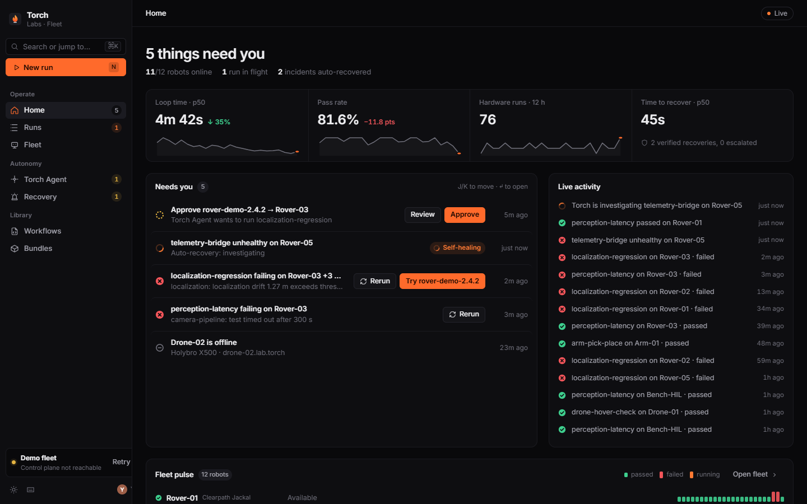
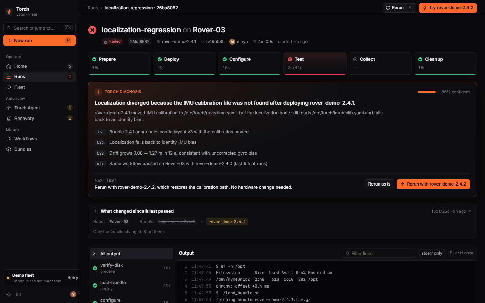
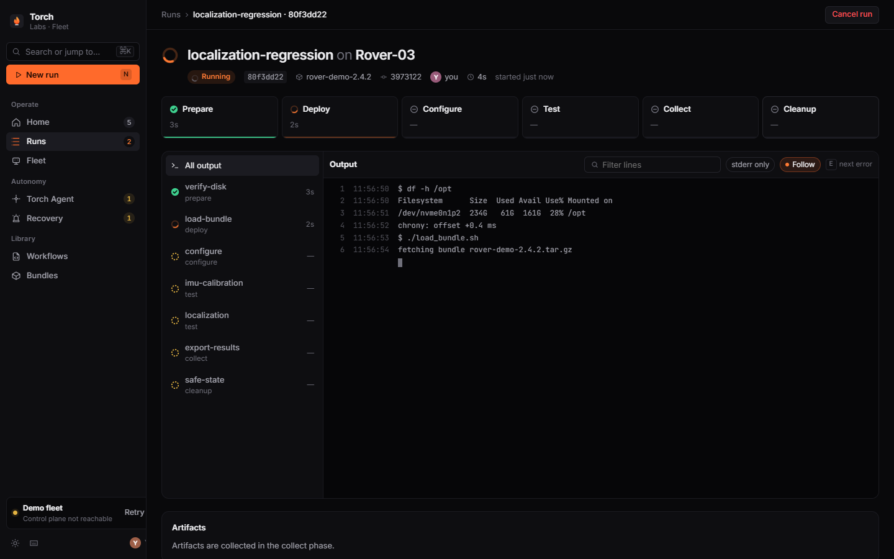
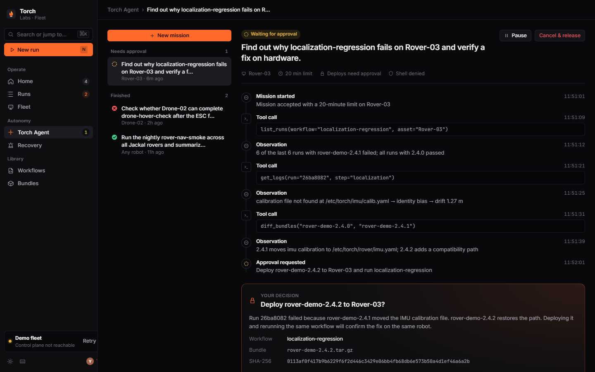
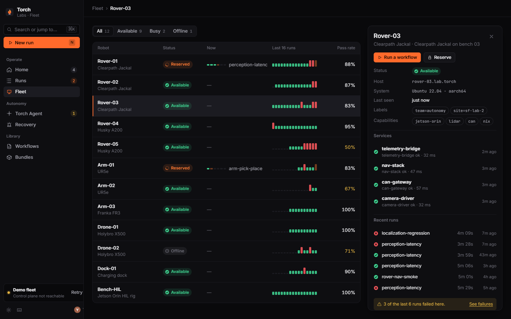
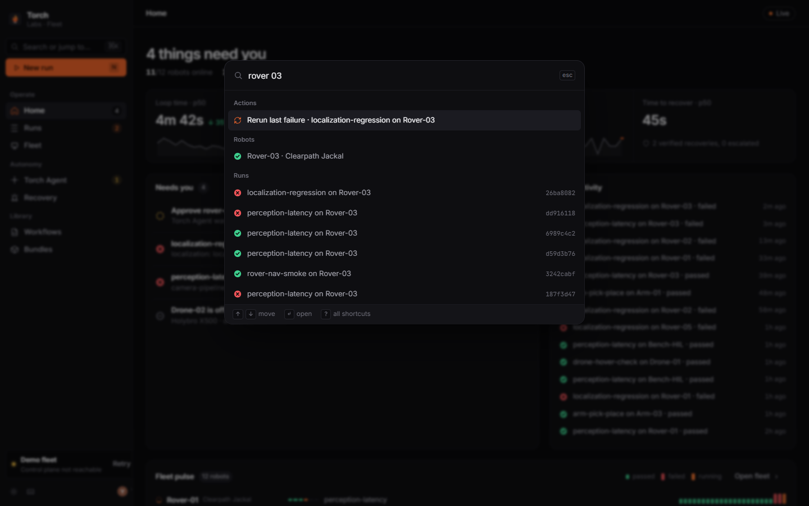
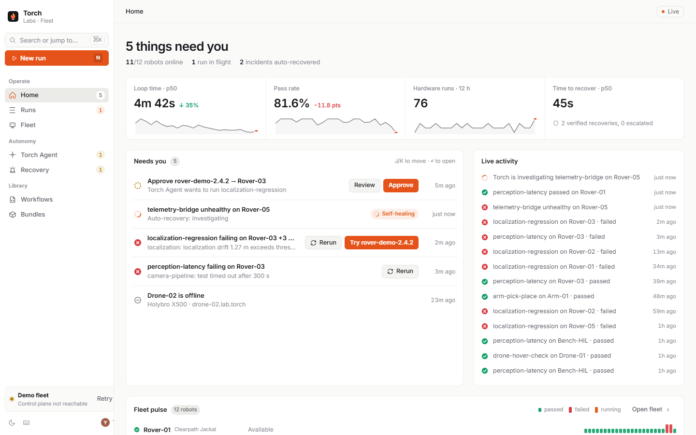

# Torch UI: research and design principles

The Torch Fleet console is built around one job: **shorten the loop from "a test failed on a robot" to "the next test is running."** Every screen either tells you what needs you, helps you understand a failure, or starts the next run.



## What we studied

We looked at the products developers already trust for speed, debugging, and reliability, then studied their real product surfaces (not their marketing pages) to see how they organize state.

| Product | What it does well | What we took |
|---|---|---|
| **Linear** | Quiet monochrome chrome. Color only for status. Dense, aligned sidebar ("inverted L"). Keyboard first. Their UI redesign reduced noise in headers and tabs and raised navigation density. | Neutral palette with a single accent, 13px Inter, sidebar plus sticky page header, ⌘K, J/K list navigation |
| **Vercel** | Web Interface Guidelines: URL as state, real links, optimistic actions, honest loading, tabular numbers, focus management | Filters live in the URL. Links are real anchors. Toasts offer Undo or follow-up. Modals trap and return focus. Tabular numbers everywhere |
| **GitHub Actions / Buildkite** | The run list *is* the dashboard: status glyph, title, mono metadata line, right-aligned duration. Steps with per-step durations | Runs list and Run detail layout, grouped by day |
| **Railway** | Deploy view: a status chip, a timestamped log table with durations, a success toast | Streaming log viewer with line numbers, timestamps, and "Follow" |
| **Sentry** | Groups similar errors into one issue. AI root cause (Seer) shown as a reasoning chain with evidence | Inbox groups failures that share a workflow and failing step. Torch diagnosis with clickable evidence that jumps to log lines |
| **incident.io** | Shows the whole loop from page to investigation to fix. A structured "what failed exactly" | Recovery page: Detect → Diagnose → Authorize → Repair → Verify, timed against detection |
| **Cursor / Linear agents** | Agent work as an inbox: In progress or Ready for review. Tool calls shown inline. Steer box | Torch Agent: missions grouped by Needs approval / In progress / Finished. Tool-call thread, approval card, steer input |
| **Warp** | A live grid of agent tasks: the system visibly *alive* | Fleet pulse: per-robot run history that updates as runs finish |
| **Foxglove / Formant** (robotics) | Credible physical-AI context, but cinematic or data-viz heavy | Deliberately different: product-forward and developer-first, not cinematic |

Mobbin's API wasn't available on our plan, so this research used the live products directly.

## Principles

1. **Lead with what needs you.** Home opens with one sentence ("5 things need you") and a decision queue, not vanity KPIs. Approvals rank first, then live incidents, failures, and offline robots. A failure leaves the queue once a later run of the same workflow passes on the same robot.
2. **One click from failure to next test.** Every failure offers *Rerun*. When a newer build of the same bundle exists, it offers *Try rover-demo-2.4.2* directly: from the inbox, the run header, and the diagnosis card.
3. **Explain with evidence.** The diagnosis cites log lines (`L23`); clicking one scrolls to the line and highlights it. "What changed since it last passed" compares only the inputs that can change the outcome (robot, bundle) and says where to start.
4. **Color means state.** The chrome is neutral. Ember (`--accent`) marks the primary action, focus, and live work, since a torch means something is lit. Status colors are reserved, and they always pair with a glyph shape (filled check, filled ×, spinner, dashed ring). In run history, pass is a short bar and fail is a tall one, so color-blind readers still see clusters.
5. **The system is visibly alive.** Live runs stream logs, phase bars pulse, the activity feed updates, and incidents walk through their stages in place. Motion only ever reflects real state, and it respects `prefers-reduced-motion`.
6. **Keyboard first, web native.** ⌘K or `/` for everything, `N` new run, `G` then `H/R/F/A/I/W` to navigate, `J/K` and `↵` in lists, `R` rerun, `E` next error line, `?` help. Navigation uses real `<a>` links, so cmd-click and copy-link work.
7. **Humans approve consequential actions.** The agent's boundaries are visible before you start ("Runs on its own / Asks you first / Never"). Deploys stop at an approval card that shows the bundle SHA-256 and the reason.
8. **Never an empty screen.** If the control plane isn't reachable, the console runs a bundled demo fleet, labeled clearly in the sidebar. Every empty state explains the next step.

## Screens

| | |
|---|---|
|  |  |
| Run detail: phase pipeline, Torch diagnosis with evidence, and what changed since the last pass | Rerun with the fix: steps and logs stream live with Follow |
|  |  |
| Agent mission: tool-call thread and approval gate | Fleet: run history, pass rate, and a robot drawer with services |
|  |  |
| ⌘K: actions, robots, runs, incidents, workflows | Light theme from the same tokens |

## Running it

```bash
cd frontend && npm install && npm run dev
```

With the control plane up (`make dev-control-plane`), the console is live against `VITE_API_URL` (default `http://localhost:8080`). Without it, the console starts the demo fleet automatically. Add `?demo` to any URL to force demo mode, and use **Retry** in the sidebar to reconnect.

## Code map

- `src/lib/engine.ts` defines the `Engine` contract and `LiveEngine` (polls the control plane and watches any detail view on screen).
- `src/lib/demo.ts` is `DemoEngine`: a seeded 24-hour history plus a live simulation (runs progress, an incident self-heals, the agent waits for approval).
- `src/lib/derive.ts` holds the pure views: the needs-you queue, loop-time and pass-rate metrics, newer-bundle detection, and the last passing run.
- `src/app/App.tsx` is the shell: sidebar, ⌘K palette, New run dialog, shortcuts.
- `src/pages/*` holds Home, Runs, RunView, Fleet, Agent, Incidents (Recovery), and Library (Workflows and Bundles).
- `src/styles/tokens.css` holds the theme tokens (dark and light). `src/styles/app.css` holds the components.

## Known gaps (backend)

- **Run diagnosis:** shown inline only for demo runs. Live runs offer "Investigate with Torch Agent", which starts a mission. A `diagnosis` field on `/runs/{id}` would light this up.
- **Activity feed:** live mode derives it from status changes between polls. An SSE or WebSocket feed would make it instant.
- **Bundle and commit metadata:** shown when the API provides `bundle_name`, `commit`, and `actor` on runs.
